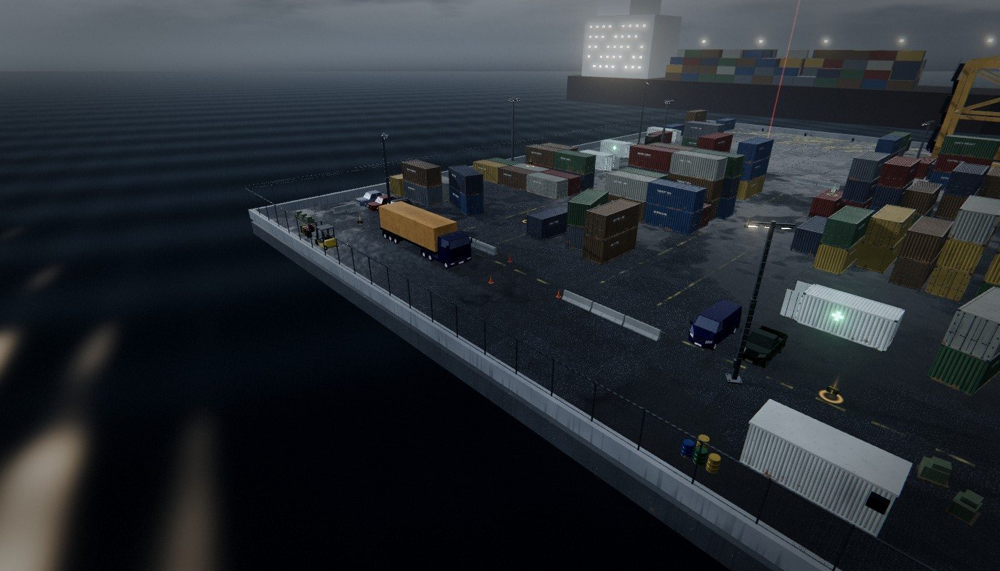
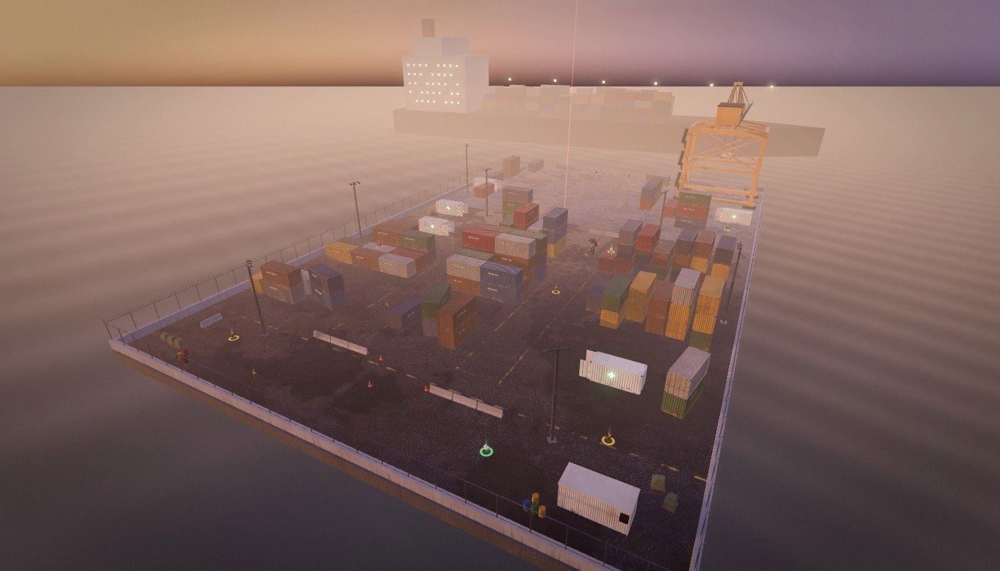
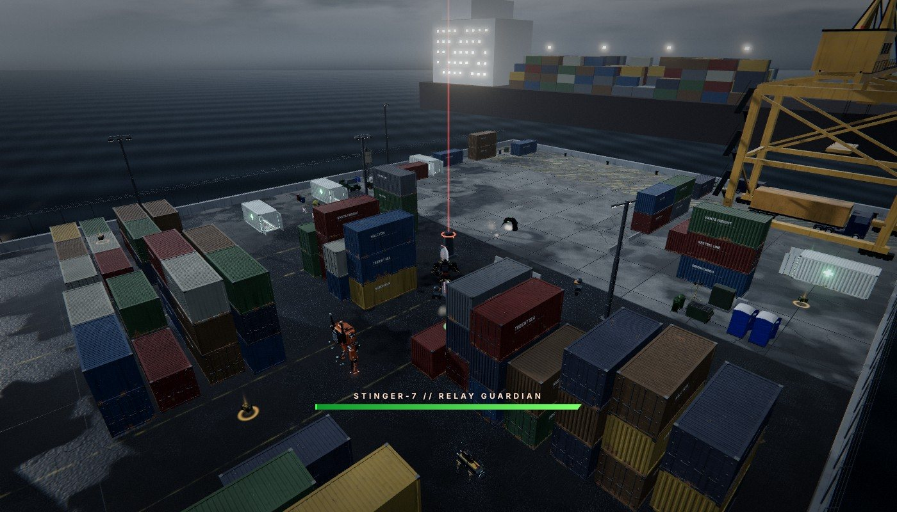
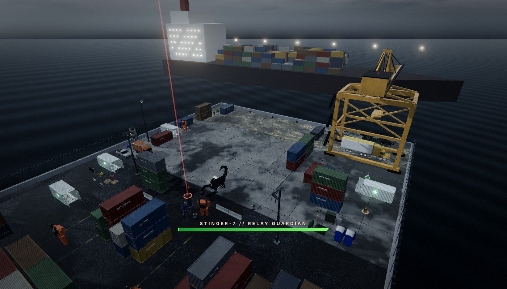
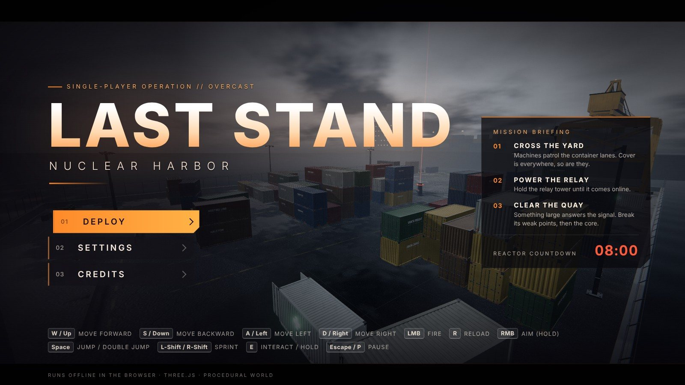
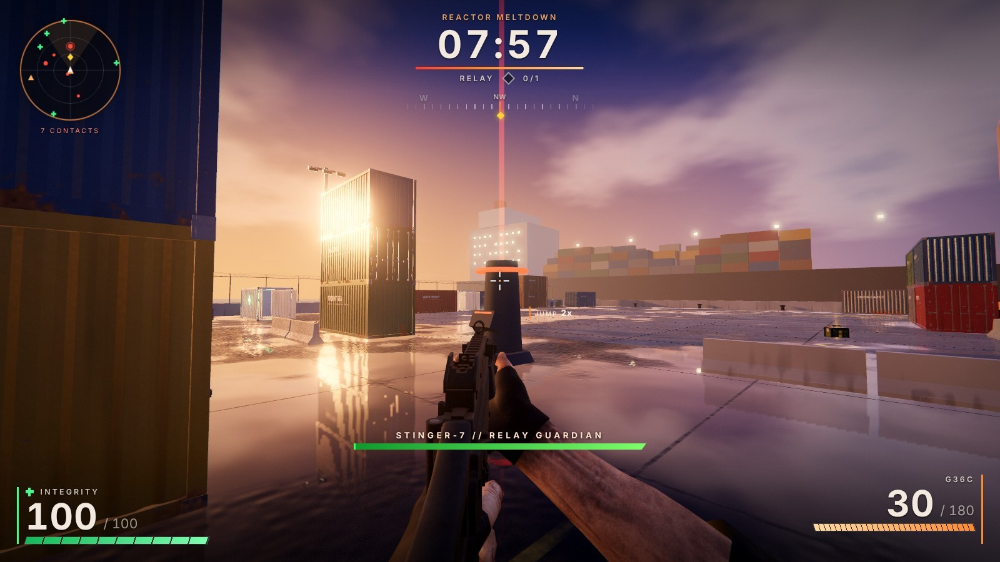
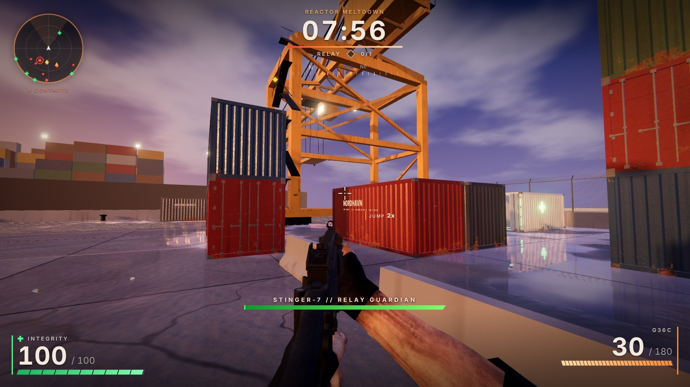
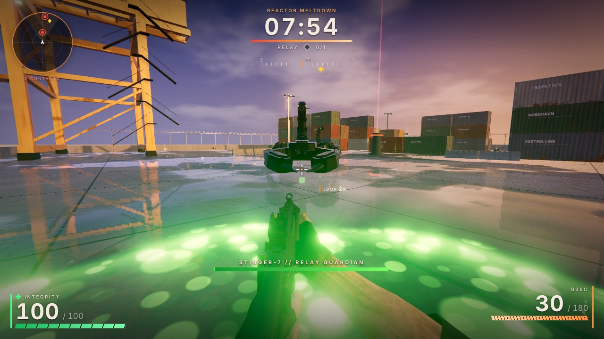
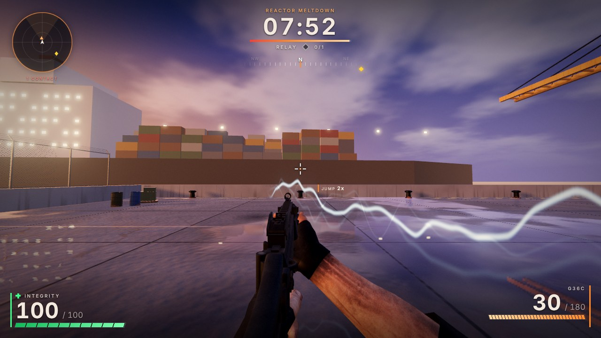

<div align="center">

# LAST STAND: NUCLEAR HARBOR

**A single-player browser FPS on a container quay at sunset, still wet from the rain and taken over by military robots.**
Fight through the yard, bring down STINGER-7, the mecha scorpion that guards the relay tower, then TITAN-04, before the countdown ends.

### [▶ Play the live demo](https://nhhthong.github.io/nuclear-harbor/)

[](https://nhhthong.github.io/nuclear-harbor/)
[](https://github.com/nhhthong/nuclear-harbor/actions/workflows/pages.yml)
[](LICENSE)
[](https://www.typescriptlang.org/)
[](https://threejs.org/)
[](https://vite.dev/)
[](https://rapier.rs/)
[-blue)](#offline-play)
[](#project-status)

<a href="https://nhhthong.github.io/nuclear-harbor/"></a>

<sub>No install, no account, no network after the first load. Desktop browser with WebGL2 and a GPU recommended; pick the Low preset on integrated graphics.</sub>

</div>

---

## Table of contents

- [Overview](#overview)
- [Screenshots](#screenshots)
- [Features](#features)
- [Gameplay](#gameplay)
- [Controls](#controls)
- [Getting started](#getting-started)
- [Publishing to GitHub Pages](#publishing-to-github-pages)
- [URL parameters](#url-parameters)
- [Architecture](#architecture)
- [Performance](#performance)
- [Offline play](#offline-play)
- [Quality assurance](#quality-assurance)
- [Project status](#project-status)
- [Documentation](#documentation)
- [Contributing](#contributing)
- [Credits and licenses](#credits-and-licenses)

## Overview

You are the only survivor of a container quay whose defence robots have been hijacked. The rain has just stopped, the sun is going
down, and the nuclear control system is counting down from **08:00**. Push through the port-style container yard, reach
the relay tower in the court behind it, where **STINGER-7** (a mecha scorpion) rises out of the ground, and hold **E**
to activate the tower while the robots close in. Then **TITAN-04**,
a four-legged spherical war machine that can only be hurt through its lights, drops onto the quay.

The game runs entirely in the browser on **Three.js + TypeScript**, with **Rapier** physics, a fixed 60 Hz
simulation, procedural audio and procedurally built models. There is no backend and no network access at runtime.

> **Honest scope note.** One small level (72 x 122 m), built to look as good as code-generated content can:
> modelled containers, wet ground with a real planar reflection, a low sun with one shadow map, a procedural
> sunset sky, bloom, ambient occlusion and a film grade. There are no scanned or sculpted assets, so it does not match a
> AAA production; see [Project status](#project-status).

## Screenshots

### The level from above

<div align="center">
  
</div>

<sub>Straight down, north at the top: the gate apron (spawn, no robots) at the bottom, then the container yard, the relay court around the tower, and the quay with the gantry crane and the boss arena. White boxes are the safe containers.</sub>

### Zone tour

<table>
  <tr>
    <td width="50%"><br><sub><b>C, gate apron.</b> Spawn, site office, barriers; no robots within 32 m.</sub></td>
    <td width="50%"><br><sub><b>A, container yard.</b> Rows, columns and loose dumps between off-centre lanes.</sub></td>
  </tr>
  <tr>
    <td width="50%"><br><sub><b>B, relay court.</b> The tower and its guardian, STINGER-7.</sub></td>
    <td width="50%"><br><sub><b>D, quay.</b> Gantry crane, staged boxes, the boss arena and the moored ship.</sub></td>
  </tr>
</table>

### In the game

<table>
  <tr>
    <td width="50%"><br><sub>Main menu: live crane shot of the level, mission briefing</sub></td>
    <td width="50%"><br><sub>Container yard: a cyber samurai at the end of the lane; HUD with radar, heading tape, health and magazine bars</sub></td>
  </tr>
  <tr>
    <td width="50%"><br><sub>Relay court, looking into the low sun</sub></td>
    <td width="50%"><br><sub>Quay: gantry crane, concrete slabs, a safe container on the right</sub></td>
  </tr>
</table>

### The robots

<table>
  <tr>
    <td width="50%"><br><sub>STINGER-7, the relay guardian</sub></td>
    <td width="50%"><br><sub>Venom shot: the pool keeps hurting for five seconds</sub></td>
  </tr>
  <tr>
    <td width="50%"><br><sub>Cyber samurai, the elite</sub></td>
    <td width="50%"><br><sub>Lightning dashes leave a fading trail</sub></td>
  </tr>
</table>

<sub>All images were captured from the production build with software rendering (no GPU), quality preset "medium"; the overhead and zone shots use a free camera, the others show the real first-person view.</sub>

## Features

**Combat**
- Automatic rifle with magazine, reserve ammo, reload, spread and recoil, critical hits (2x), pooled tracers, muzzle flash with a real point light and ejected casings.
- Hit zones on enemies: Duck and Spot noses/heads crit, armour absorbs, the boss only takes damage through its weak points.
- Pickups: ammo crates and medkits placed around towers and lanes, plus a chance of an ammo drop from destroyed robots.

**Movement**
- Rapier kinematic capsule controller: walk, sprint, **high jump and double jump** (3.9 m, 7.2 m chained: two-high stacks are climbable, three-high ones are not), step-up, coyote time and jump buffering.
- **Safe containers**: five containers with the doors open. Step inside and the walls stop bullets; standing there heals 12 HP/s once nothing has hit you for a moment. Robots cannot enter.
- Level boundaries and invisible walls so every run stays inside the quay.

**Interface**
- Segmented health bar with a lagging damage ghost, magazine bar with reload progress, countdown with a remaining-time bar, heading tape, hit marker and lower-third toasts.
- **Radar** (top left, 42 m, up is where you look): robots, elites and bosses, the relay tower and the safe containers.
- Cinematic main menu over a live crane shot of the quay, with mission briefing and key chips.

**Enemies** (a roster of 21 robots plus two bosses; all procedural models with LOD and walk cycles paced by the ground covered, so feet do not slide)
- **Vanguard army mech** (5): slow patrols, then smooth, disciplined advance and rocket salvos.
- **Spot dog** (8): weak and fast, lunges and rams.
- **Bomber Duck** (5): hops toward you, arms a **3-2-1** countdown and blows up for 15 damage.
- **Cyber samurai** (3, elite): 300 HP, twice a regular robot. One per area (yard, gate apron, quay), never in the scorpion's court. A quick cut up close, a **leap and cleave** from up to 17 m, a **spinning polearm** that deflects 85% of frontal fire for 3 s when it is being shot, and twice per life (below 70% and 35% HP) a burst of six **lightning dashes** across an 8.5 m area that leaves faint lightning behind.
- **STINGER-7 semi-boss** (mecha scorpion, about 6 m long, 1300 HP): rises behind the relay tower when you approach it. Three telegraphed skills: a **charge** that throws you straight back, a **venom shot** (green glob, burst damage and a pool that hurts for 5 s) and a **tail slam** whose blasts run out in a fan in front of it. Under sustained fire it crosses its claws and raises a **hexagon shield** that blocks 80% of frontal damage for a few seconds, so flank it or wait. It is stunned after ramming a wall and enrages below 40% HP. Weak spots: head sensors and the stinger bulb.
- **Area streaming**: no robot exists at load. Posts around you wake up as you walk (within 46 m, never closer than 18 m, never within 32 m of the spawn), at most 10 are alive at once, and survivors far behind you are removed again.
- **TITAN-04 final boss** (about 9 m tall): falls from the sky after the tower is activated, four knee-light weak points, then an exposed core.

**World and rendering**
- One quay at sunset (72 x 122 m): gate apron, container yard, relay court and the quay with a gantry crane.
- **Port-style yard**: fixed off-centre lanes, and every block between them is filled in its own style (long rows, short columns or a loose dump with boxes set down at an angle) with uneven stacks, holes and ragged ends, all from a seeded generator.
- **Containers as geometry**, not textured boxes: corrugated walls and roof, frame, doors with locking bars, corner castings, livery decals; one shader adds chipped paint, rust and grime.
- **Wet ground shader**: asphalt and concrete slabs, cracks, worn paint, crane rails, still puddles and a **planar reflection** of the whole scene (a third of the resolution and every other frame on medium, half resolution every frame on high).
- **Lighting**: the low sun is the only real light (one shadow map), plus a hemisphere fill, a procedural sunset sky with drifting cloud, light haze and a sky reflection probe. Lamp heads are emissive only.
- **Post-processing**: MSAA HDR target, ambient occlusion (high preset), bloom, ACES tone mapping, a NaN guard in front of the bloom, then a grade pass with vignette, film grain and slight chromatic aberration.
- Detailed gantry crane, chain-link fence, site office, barriers, drums, pallets, bollards; ocean shader and a moored ship with lit windows.

**Engineering**
- Module registry with explicit init and update order, a typed event bus, a single `tunables` file for gameplay numbers.
- Object pools, resource tracking with `dispose()` on every module, AI update scheduling by distance.
- Quality presets (shadows, resolution cap, view distance, bloom, FPS cap), settings persisted locally.
- Procedural Web Audio (no audio files), service worker for offline play, built-in debug overlay and benchmark mode.

## Gameplay

```
Gate apron (empty) -> container yard -> relay court: STINGER-7, hold the tower
           -> TITAN-04 drops onto the quay -> destroy 4 weak points -> shoot the exposed core -> victory
```

| Element | Details |
|---|---|
| Countdown | 8 minutes; reaching zero is a failure |
| Tower | 1; stand within range and hold `E` (5 s). Leaving range or dying cancels the progress |
| Death | Respawn at the last checkpoint when one exists (the activated tower, the boss start); the countdown keeps running |
| Robots | roster of 21, streamed in around you (10 alive at most): 5 army mechs, 8 Spot dogs, 5 Bomber Ducks, 3 cyber samurai |
| Semi-boss | STINGER-7, 1300 HP, guards the relay tower |
| Final boss | TITAN-04: 4 weak points x 500 HP, then core 4000 HP; Heavy Cannon, Ground Slam and Missile Barrage |
| Supplies | 16 ammo crates and 6 medkits (6 + 2 of them around the boss arena); two on container tops (double jump) |
| Recovery | Five safe containers heal 12 HP/s while you stand inside |

Enemy and weapon numbers are starting values and have **not** been balanced by play-testing.

## Controls

| Action | Input |
|---|---|
| Move | `W` `A` `S` `D` |
| Look | Mouse |
| Fire | Left mouse button |
| Aim down sights | Hold right mouse button |
| Reload | `R` (Settings: Auto reload, on by default) |
| Jump / double jump | `Space` (press again in the air) |
| Sprint | `Shift` |
| Interact / activate tower | Hold `E` |
| Pause | `P` or `Esc` |
| Debug overlay | `F3` or `` ` `` |

Bindings can be changed in the menu. Settings: mouse sensitivity, volume, graphics quality (low, medium, high) and FPS cap.

## Getting started

**Requirements:** Node.js 20 or newer and a WebGL2-capable browser. A GPU is strongly recommended; software rendering works but is slow.

```bash
git clone https://github.com/nhhthong/nuclear-harbor.git
cd nuclear-harbor
npm install
npm run dev          # http://localhost:5173/
```

Production build and local preview:

```bash
npm run build
npm run preview      # http://localhost:4173/
```

The first click on the canvas locks the pointer. Add `?autostart` to skip the menu and `?sandbox` for the small test scene.

### Scripts

| Command | What it does |
|---|---|
| `npm run dev` | Vite dev server with hot reload |
| `npm run build` | Type-aware production build into `dist/` |
| `npm run typecheck` | `tsc --noEmit` (strict) |
| `npm test` | Vitest unit tests |
| `npm run smoke` | Playwright: built app boots, renders, no console errors (needs a build) |
| `npm run e2e -- T-XX` | Per-feature browser checks in `tests/e2e/` (see the note in [Quality assurance](#quality-assurance)) |
| `npm run offline` | Proves the built game boots with the network blocked after one load |
| `npm run leakcheck` | Dispose/re-create cycles return GPU and JS resources to baseline |
| `npm run bench` | Benchmark scenes x quality presets (relative numbers on software GL) |
| `npm run check` | typecheck + tests + build + smoke |

## Publishing to GitHub Pages

The **[live demo](https://nhhthong.github.io/nuclear-harbor/)** is built and deployed by `.github/workflows/pages.yml`:

- every push and pull request runs the checks (typecheck, unit tests, production build);
- pushes to `main` also deploy `dist/` to GitHub Pages.

One-time setup: repository **Settings, Pages, Source: GitHub Actions**. The build uses relative paths, so it works under
`https://<user>.github.io/<repository>/` without changing `base`.

## URL parameters

Handy for development and testing; none are required to play.

| Parameter | Effect |
|---|---|
| `?autostart` | Skip the main menu |
| `?sandbox` | Small flat test scene instead of the harbor |
| `?debug` | Debug overlay (FPS, frame time, draw calls, resources) |
| `?colliders` | Draw physics colliders |
| `?enemies=army,spot,duck` or `none` | Robots in the sandbox |
| `?countdown=SECONDS` | Override the nuclear countdown |
| `?towers=N` | Start with N towers already active |
| `?boss` / `?bossphase=core` | Spawn TITAN-04 shortly after start / jump to the core phase |
| `?viewmodel=procedural` | Use the placeholder rifle instead of the G36C model |
| `?bench=SECONDS` | Run the benchmark and print a `BENCH {json}` line |

## Architecture

```
src/
  core/        game loop (fixed 60 Hz + interpolated render), renderer, input, event bus, settings, shared types
  config/      level layout (level.ts) and every gameplay number (tunables.ts)
  physics/     Rapier wrapper: character controller, static boxes, ray and shape queries, collision groups
  world/       wet ground + planar reflection, modelled containers, sunset sky, sun, haze, ocean, ship, kerb
  structures/  gantry crane, flood-light masts (emissive lamps), fence, props
  shelters/    safe containers: heal while the player stands inside
  player/      first-person controller (walk, sprint, jump, double jump)
  weapon/      rifle logic, recoil, procedural and GLB view models, pooled weapon effects
  combat/      damage and hit resolution
  scorpion/    STINGER-7 semi-boss: model, skills, telegraph shaders, drops
  enemies/     framework, army mech, Spot, Bomber Duck, cyber samurai, nav grid, AI scheduler, area streaming, gait
  boss/        TITAN-04: model, attacks, weak points, landing cinematic
  objectives/  towers and nuclear countdown
  pickups/     ammo, medkits and drops
  flow/        death, game over, victory, checkpoints
  vfx/         pooled particle system and effect recipes
  audio/       procedural Web Audio synthesis and the event-to-sound map
  ui/          HUD, menus, settings, credits
  debug/       overlay, collider view, benchmark
  offline/     service worker registration
  modules.ts   module registry: init order = update order
```

Design rules (full text in [`.specify/memory/constitution.md`](.specify/memory/constitution.md) and [`docs/PLAN.md`](docs/PLAN.md)):

- **Modules, not singletons.** Each feature is a `GameModule` registered in `src/modules.ts` and talks to others through typed events and the shared `GameContext`.
- **Fixed-step simulation.** Logic and physics run at 60 Hz; rendering is independent and interpolates the camera.
- **No unbounded allocation.** Frequently created objects come from bounded pools; per-frame code reuses scratch objects.
- **Everything is disposable.** GPU resources are owned by a `ResourceTracker` scope and released in `dispose()`.
- **One source of numbers.** Gameplay values live in `src/config/tunables.ts` or the module's own `tunables.ts`.

## Performance

| Budget | Value |
|---|---|
| Target | 60 FPS desktop, 30 FPS low-end fallback |
| Draw calls | at most 350 per frame; measured about 100 to 180 including the reflection pass |
| Triangles | about 0.45 to 0.6 million per frame with shadow and reflection passes (measured) |
| Enemies | roster of 21 robots (18 regular, 3 samurai) streamed by area (10 alive at most), STINGER-7 and the boss |
| Shadows | one sun shadow map, static content refreshed at 6 Hz (medium) or 12 Hz (high) for moving casters |
| Presets | low: no shadows, reflection or bloom; medium: shadows, reflection, bloom; high: adds ambient occlusion |
| Bundle | about 5.3 MB (Rapier's WASM is about 80% of it), split into three chunks |

The numbers above come from the debug overlay and the smoke test on **software rendering**. No benchmark on real
hardware has been recorded yet: run `?autostart&bench=20` on your machine and see
[`docs/PERFORMANCE.md`](docs/PERFORMANCE.md) for the table to fill in.

## Offline play

The production build registers a hand-written service worker that precaches every built file (including the
weapon model). Open the game once while online and wait a few seconds; afterwards it starts without a network and
the browser can install it as an app. Details, updates and cache reset: [`docs/OFFLINE.md`](docs/OFFLINE.md).
The service worker is not registered by `npm run dev`.

## Quality assurance

- `npm run typecheck`, `npm test` (**437 unit tests in 67 files**) and `npm run build` pass on the current branch and run in CI on every push.
- `npm run smoke` and `npm run offline` passed on an earlier map and were not re-run after the later reworks.
- **The `tests/e2e/` files are out of date.** They still contain old-map coordinates, four towers and steps for the removed grappling hook, so they were not run after the level rework. Update them before relying on them.
- Nobody has play-tested a full run (tower, boss, victory) yet, so difficulty and pacing are unverified.
- The look was checked on still screenshots from software rendering only; frame rate on a real GPU is unmeasured.

## Project status

**Prototype.** The game is complete end to end in design (start, tower, boss, victory and failure paths) but unproven in play.

Known limitations:

- Visuals are procedural; there is no authored art, so realism is limited by design. The robots and the scorpion are built from primitives and read as low-poly next to the environment.
- The heavy shaders (planar reflection, shadow map, bloom, AO) target a desktop GPU; use the low preset on integrated graphics.
- Gameplay balance (damage, robot density, walking distances, countdown length, the heal rate of the safe containers) is untested.
- The boss attacks were checked by unit tests and short scripted runs only.
- The in-game Restart button reloads the page.
- Optional boss attacks from the GDD (Shockwave, Target Lock, EMP Pulse) are not implemented.
- Real-device performance numbers are missing.

Where the game differs from the original design document is tracked in [`docs/DEVIATIONS.md`](docs/DEVIATIONS.md).

## Documentation

| Document | Contents |
|---|---|
| [`docs/GDD.md`](docs/GDD.md) | Original game design document (Vietnamese) |
| [`docs/DEVIATIONS.md`](docs/DEVIATIONS.md) | What was built differently from the GDD; read it next to the GDD |
| [`docs/PLAN.md`](docs/PLAN.md) | Architecture, module boundaries, events, conventions |
| [`docs/tickets/`](docs/tickets/README.md) | Work tickets and their status |
| [`docs/PLAYTEST.md`](docs/PLAYTEST.md) | Scripted playtest findings (taken on the previous map) |
| [`docs/PERFORMANCE.md`](docs/PERFORMANCE.md) | Budgets, benchmark method and results table |
| [`docs/OFFLINE.md`](docs/OFFLINE.md) | Service worker and install instructions |
| [`docs/ASSETS.md`](docs/ASSETS.md) | Asset provenance and credits |
| [`docs/CLEANUP-LOG.md`](docs/CLEANUP-LOG.md) | What was removed or renamed and why |
| [`CLAUDE.md`](CLAUDE.md) | Orientation and working rules for AI coding sessions |

## Contributing

Issues and pull requests are welcome. Before opening a PR:

1. Run `npm run typecheck && npm test && npm run build`.
2. Keep gameplay numbers in the `tunables` files and keep new modules disposable.
3. Do not commit `node_modules`, build output, or third-party archives (see `.gitignore`).
4. Describe what you verified and what you did not.

Development of this project is organised around tickets and the [Spec Kit](https://github.com/github/spec-kit)
workflow described in [`docs/SPECKIT.md`](docs/SPECKIT.md); the repository's `specs/` folder holds the artifacts.

## Credits and licenses

**Project code** is released under the [MIT License](LICENSE).

| Component | License | Notes |
|---|---|---|
| [Three.js](https://threejs.org/) | MIT | Rendering |
| [Rapier](https://rapier.rs/) (`@dimforge/rapier3d-compat`) | Apache-2.0 | Physics |
| [Vite](https://vite.dev/), [Vitest](https://vitest.dev/) | MIT | Build and unit tests |
| [TypeScript](https://www.typescriptlang.org/) | Apache-2.0 | Language |
| G36C view model (`assets-src/weapons/g36c/`, `public/assets/weapons/g36c/`) | **Not covered by the MIT license** | Model by **funnky**, used with the author's permission as stated by the project owner. No licence text ships with the file, so confirm the terms before redistributing or selling the game. |

Everything else (models, textures, sounds, UI) is generated procedurally by this repository's code.

**Acknowledgements.** The reference models in [`docs/reference-models/`](docs/reference-models) inspired the robot
designs; they are visual references only. This project was developed with substantial help from AI coding agents
([Claude Code](https://claude.com/claude-code)) under human direction and review.
