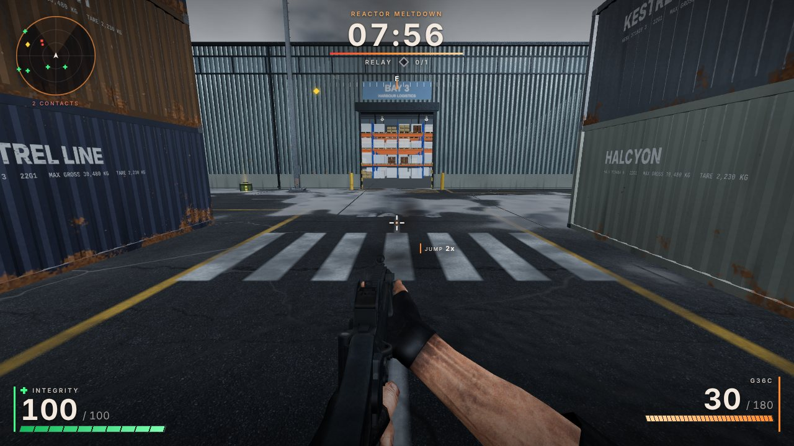
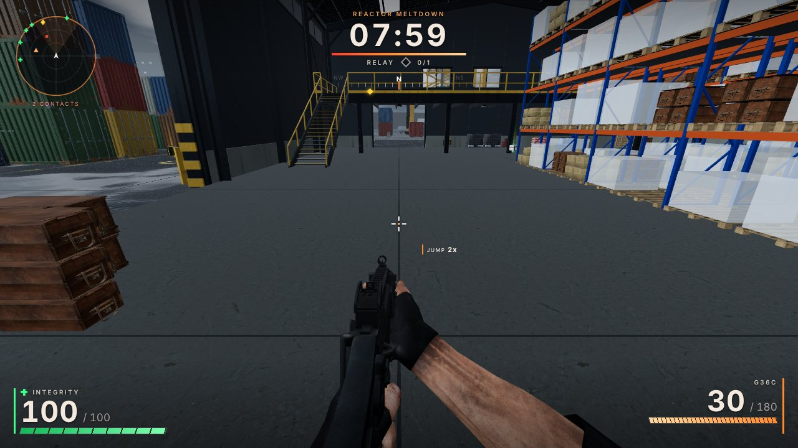
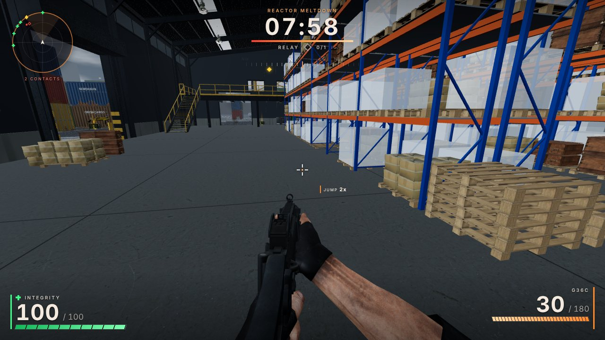
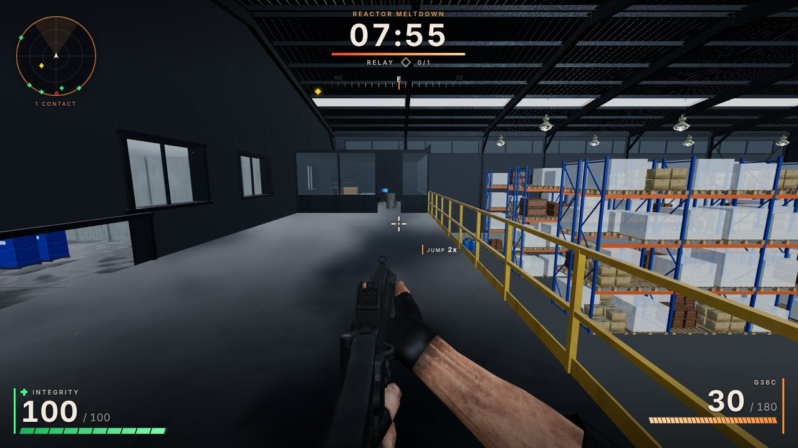
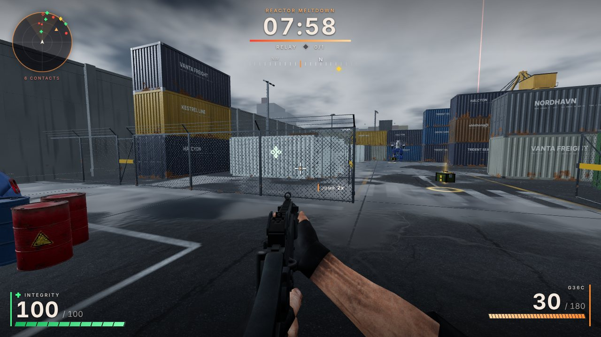
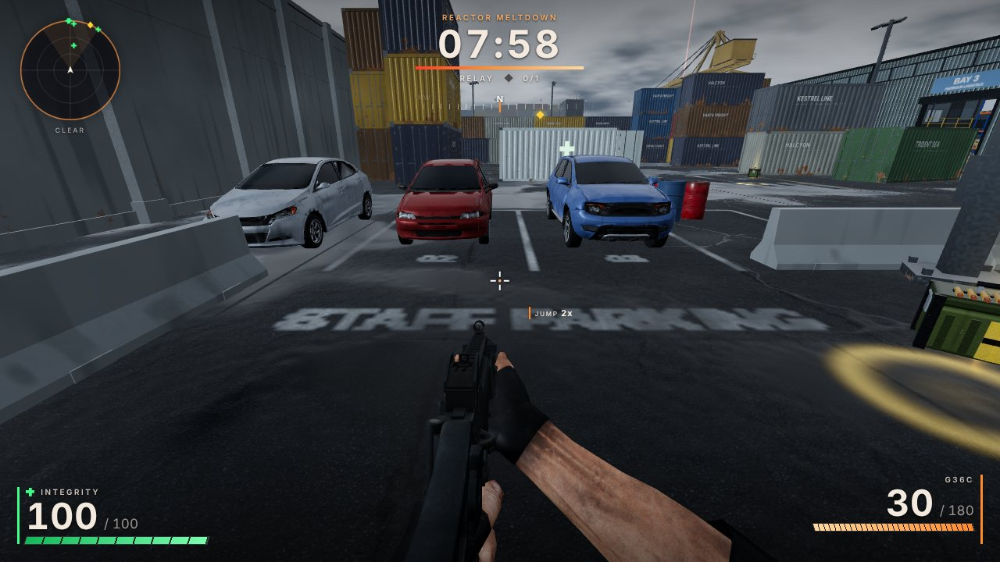
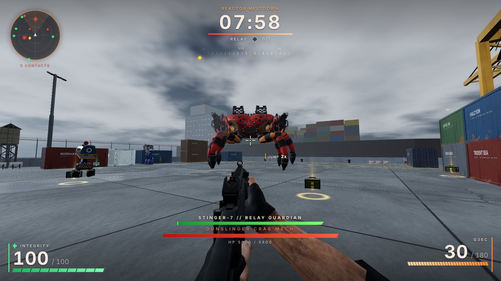

<div align="center">

# LAST STAND: NUCLEAR HARBOR

**A single-player browser FPS on a cold, overcast container quay, wet underfoot and taken over by military robots.**
Fight through the yard, bring down STINGER-7, the mecha scorpion that guards the relay tower, then the Gunslinger Crab Mech, before the countdown ends.

### [▶ Play the live demo](https://nhhthong.github.io/nuclear-harbor/)

[](https://nhhthong.github.io/nuclear-harbor/)
[](https://github.com/nhhthong/nuclear-harbor/actions/workflows/pages.yml)
[](LICENSE)
[](https://www.typescriptlang.org/)
[](https://threejs.org/)
[](https://vite.dev/)
[](https://rapier.rs/)
[-blue)](#offline-play)
[](#project-status)

<a href="https://nhhthong.github.io/nuclear-harbor/"></a>

<sub>No install, no account, no network after the first load. Desktop browser with WebGL2 and a GPU recommended; pick the Low preset on integrated graphics.</sub>

</div>

---

## Overview

You are the only survivor of a container quay whose defence robots have been hijacked. The nuclear control system counts down from **08:00**. Fight through the container yard and a steel warehouse to the relay tower, where the mecha scorpion **STINGER-7** rises, hold **E** to activate the tower, then bring down the **Gunslinger Crab Mech**, a 10 m armoured boss with one huge health bar and four skills.

**Three.js + TypeScript + Vite + Rapier**: fixed 60 Hz simulation, procedural audio, no backend, no network at runtime. One small L-shaped level (72 x 122 m, closed by a 7 m wall) with modelled containers, a two-storey warehouse, chain-link fences with swing gates, wet asphalt and concrete (CC0 scans) with painted road markings and a planar reflection, a pale sun with one shadow map, an overcast sky, bloom and a cold film grade. Robots, vehicles and clutter are free CC0 or CC-BY models ([credits](CREDITS.md)). It is a **prototype**: nobody has play-tested a full run yet, so balance and real-GPU frame rate are unverified.

## Screenshots

<div align="center">
  
</div>

<sub>Overhead, north at the top: the gate apron (spawn, car parks) and the container yard form the west leg of the L; the only way north is through the warehouse (bottom right); then the relay court (dashed ring around the tower) and the quay with the crane and the boss landing ring. White boxes are the safe containers.</sub>

<table>
  <tr>
    <td width="50%"><br><sub>The yard aisle ends at the warehouse roller door: the only way north</sub></td>
    <td width="50%"><br><sub>Inside: concrete floor, stair to the mezzanine, pallet racks</sub></td>
  </tr>
  <tr>
    <td width="50%"><br><sub>Racks loaded with wrapped pallets, cartons and crates (25 CC0/CC-BY props)</sub></td>
    <td width="50%"><br><sub>Mezzanine and glazed office; windows overlook the relay court (drones come in if you camp here)</sub></td>
  </tr>
  <tr>
    <td width="50%"><br><sub>Swing gates open when you touch them and close behind you</sub></td>
    <td width="50%"><br><sub>Road paint: parking bays, zebra crossings, lane lines, zone names</sub></td>
  </tr>
  <tr>
    <td width="50%"><br><sub><b>Biped robot</b>: crouches, leaps at where you stood, claws on landing</sub></td>
    <td width="50%"><br><sub><b>Medium Mech Striker</b>: bursts and AOE rockets</sub></td>
  </tr>
  <tr>
    <td width="50%"><br><sub><b>Cyber samurai</b> elite</sub></td>
    <td width="50%"><br><sub><b>STINGER-7</b> semi-boss: gunmetal armour, green glow</sub></td>
  </tr>
  <tr>
    <td width="50%"><br><sub><b>Gunslinger Crab Mech</b>: 5800 HP, no weak points</sub></td>
    <td width="50%"><br><sub>Skill: dragonfly drones</sub></td>
  </tr>
</table>

<sub>Captured from the production build with software rendering (no GPU), quality "low".</sub>

## Gameplay

```
Gate apron -> gate -> container yard -> warehouse (roller door, mezzanine, back door) -> relay court:
STINGER-7, hold the tower -> gate -> the Gunslinger Crab Mech drops onto the quay -> victory
```

- **Countdown** 8 minutes; zero is a failure. **Tower**: hold `E` for 5 s within range. Death respawns at the last checkpoint; the countdown keeps running.
- **Robots** (roster of 22 on foot plus 4 flying drones, streamed in as you walk, 10 alive at most; drones also come in through the windows if you camp on the mezzanine): 5 Medium Mech Strikers (3-round bursts, an AOE rocket every 6 to 9 s), 4 Biped robots (leap and claw; double jump dodges the leap), 6 Spot dogs, 4 Bomber Ducks (3-2-1 explosion), 3 cyber samurai (300 HP elites: cleave, spinning naginata, lightning dashes).
- **STINGER-7** (1300 HP): charge, venom shot, tail slam; raises a hexagon shield under sustained fire.
- **Gunslinger Crab Mech** (5800 HP): carpet bombs (AOE), dragonfly drones, a 360 degree spin up close, a slow four-way laser that rotates 180 degrees.
- **Supplies**: 12 ammo crates, 3 medkits; five safe containers heal 12 HP/s and robots cannot enter.
- Fences: touch a gate to open it; it closes about 5 s after everyone has left. Numbers are starting values and **not** balanced by play-testing.

| Action | Input |
|---|---|
| Move / look / fire | `W` `A` `S` `D` / mouse / left button |
| Aim down sights / reload | right button (hold) / `R` |
| Jump (double jump) / sprint | `Space` / `Shift` |
| Activate tower | hold `E` |
| Pause / debug overlay | `P` or `Esc` / `F3` |

Bindings, sensitivity, volume, quality (low, medium, high) and FPS cap are in the menu.

## Getting started

Node.js 20+ and a WebGL2 browser (a GPU is strongly recommended).

```bash
git clone https://github.com/nhhthong/nuclear-harbor.git
cd nuclear-harbor
npm install
npm run dev          # http://localhost:5173/
```

Verify with `npm run typecheck && npm test && npm run build` (also run by CI). Other scripts: `npm run preview`, `smoke`, `offline`, `leakcheck`, `bench` (see `package.json`).

**URL parameters** (dev and testing only): `?autostart` skips the menu, `?sandbox` small test scene (`&enemies=army,spot,duck,biped,drone` or `none`), `?debug` overlay, `?colliders`, `?countdown=SECONDS`, `?boss` / `?bossphase=core`, `?viewmodel=procedural`, `?bench=SECONDS`.

**GitHub Pages**: `.github/workflows/pages.yml` runs typecheck, unit tests and build on every push and PR and deploys `main` to the [live demo](https://nhhthong.github.io/nuclear-harbor/) (Settings, Pages, Source: GitHub Actions). **Offline**: a service worker precaches the build; open once online, then it works offline ([`docs/OFFLINE.md`](docs/OFFLINE.md)).

## Architecture

`src/` modules are registered in `src/modules.ts` (init order = update order) and talk through a typed event bus; every gameplay number lives in `src/config/tunables.ts` or a module `tunables.ts`.

`core` (loop, renderer, input, events) · `config` · `physics` (Rapier) · `world` · `structures` (crane, warehouse, props, vehicles, fences and gates) · `shelters` · `player` · `weapon` · `combat` · `scorpion` · `enemies` (Striker, Biped, Spot, Duck, samurai, drone, streaming) · `boss` (crab, drones) · `objectives` · `pickups` · `flow` · `vfx` · `audio` · `ui` · `debug` · `offline`

Budgets: 60 FPS desktop target, at most 350 draw calls (about 55 to 150 measured on software GL), about 5.3 MB of code plus about 16 MB of models and 0.9 MB of ground textures. Details: [`docs/PERFORMANCE.md`](docs/PERFORMANCE.md).

## Status and limitations

- Verified: `tsc`, **612 unit tests**, build, CI, scripted browser checks on the low preset. Not verified: a full run, balance, frame rate on a real GPU. `tests/e2e/` scripts are stale and `smoke` was not re-run after the reworks.
- A drone charging a shot right next to the camera shows a large pale glow; the Bomber Duck is primitive-built and reads as low-poly (the scorpion is an authored model with a procedural fallback; its legs swing rigidly about the hips, so feet slide a little); the crab can show a pale orange wash while a skill telegraphs; the in-game Restart reloads the page.
- Differences from the original design: [`docs/DEVIATIONS.md`](docs/DEVIATIONS.md). Architecture and conventions: [`docs/PLAN.md`](docs/PLAN.md). Assets: [`docs/ASSETS.md`](docs/ASSETS.md). AI session rules: [`CLAUDE.md`](CLAUDE.md).

## Contributing

Run `npm run typecheck && npm test && npm run build`, keep gameplay numbers in the `tunables` files, do not commit `node_modules` or third-party archives, and say what you verified and what you did not. New features follow [Spec Kit](https://github.com/github/spec-kit) ([`docs/SPECKIT.md`](docs/SPECKIT.md); artifacts in `specs/`).

## Credits and licenses

Project code: [MIT License](LICENSE). Third-party models are CC0 or CC-BY 4.0 (Sketchfab, Poly Haven, 3DModelsCC0, OpenGameArt); the G36C view model is **not** covered by the MIT license. Full tables, authors, changes and build scripts: **[CREDITS.md](CREDITS.md)** (also in the in-game Credits screen and [`docs/ASSETS.md`](docs/ASSETS.md)).
