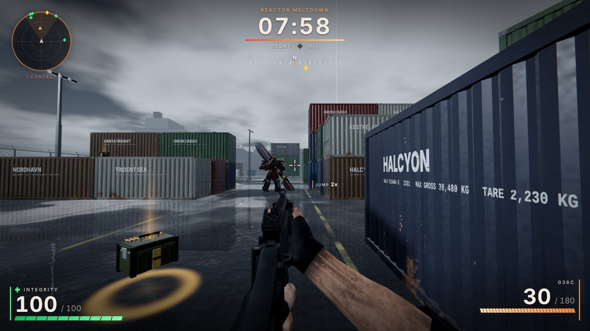
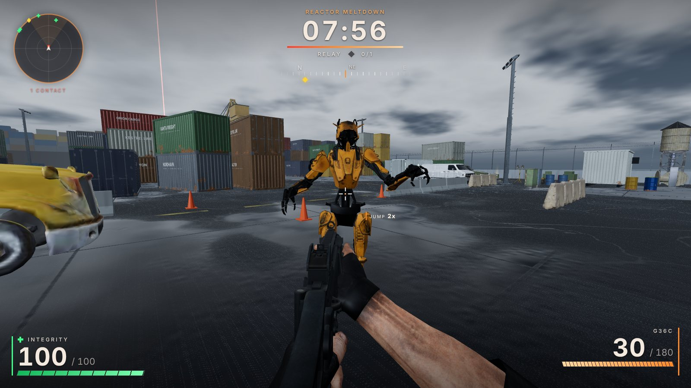
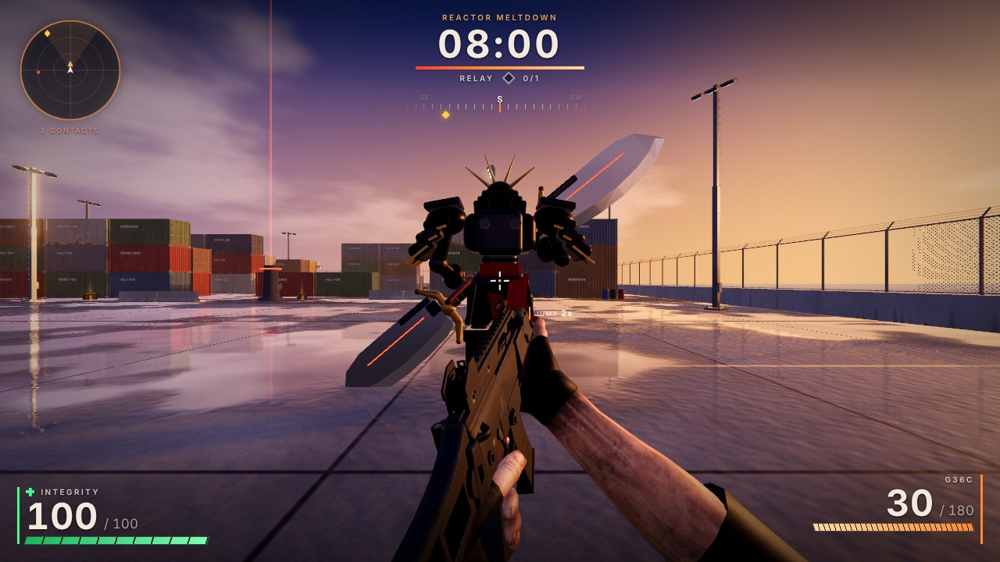
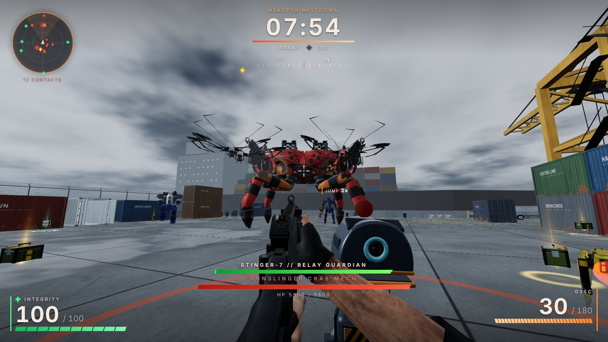

<div align="center">

# LAST STAND: NUCLEAR HARBOR

**A single-player browser FPS on a cold, overcast container quay, wet underfoot and taken over by military robots.**
Fight through the yard, bring down STINGER-7, the mecha scorpion that guards the relay tower, then the Gunslinger Crab Mech, before the countdown ends.

### [▶ Play the live demo](https://nhhthong.github.io/nuclear-harbor/)

[](https://nhhthong.github.io/nuclear-harbor/)
[](https://github.com/nhhthong/nuclear-harbor/actions/workflows/pages.yml)
[](LICENSE)
[](https://www.typescriptlang.org/)
[](https://threejs.org/)
[](https://vite.dev/)
[](https://rapier.rs/)
[-blue)](#offline-play)
[](#project-status)

<a href="https://nhhthong.github.io/nuclear-harbor/"></a>

<sub>No install, no account, no network after the first load. Desktop browser with WebGL2 and a GPU recommended; pick the Low preset on integrated graphics.</sub>

</div>

---

## Overview

You are the only survivor of a container quay whose defence robots have been hijacked. The nuclear control system counts down from **08:00**. Fight through the container yard to the relay tower, where the mecha scorpion **STINGER-7** rises, hold **E** to activate the tower, then bring down the **Gunslinger Crab Mech**, a 10 m armoured boss with one huge health bar and four skills.

**Three.js + TypeScript + Vite + Rapier**: fixed 60 Hz simulation, procedural audio, no backend, no network at runtime. One small level (72 x 122 m) with modelled containers, wet ground with a planar reflection, a pale sun with one shadow map, an overcast sky, bloom and a cold film grade. Robots, vehicles and clutter are free CC0 or CC-BY models ([credits](#credits-and-licenses)). It is a **prototype**: nobody has play-tested a full run yet, so balance and real-GPU frame rate are unverified.

## Screenshots

<div align="center">
  
</div>

<sub>Overhead, north at the top: gate apron (spawn, no robots), container yard, relay court around the tower, quay with the crane and boss arena. White boxes are the safe containers.</sub>

<table>
  <tr>
    <td width="50%"><br><sub>Container yard lane</sub></td>
    <td width="50%"><br><sub>Relay court</sub></td>
  </tr>
  <tr>
    <td width="50%"><br><sub><b>Biped robot</b>: crouches, leaps at where you stood, claws on landing</sub></td>
    <td width="50%"><br><sub><b>Medium Mech Striker</b>: bursts and AOE rockets</sub></td>
  </tr>
  <tr>
    <td width="50%"><br><sub><b>Cyber samurai</b> elite</sub></td>
    <td width="50%"><br><sub><b>STINGER-7</b> semi-boss: gunmetal armour, green glow</sub></td>
  </tr>
  <tr>
    <td width="50%"><br><sub><b>Gunslinger Crab Mech</b>: 5800 HP, no weak points</sub></td>
    <td width="50%"><br><sub>Skill: dragonfly drones</sub></td>
  </tr>
</table>

<sub>Captured from the production build with software rendering (no GPU). Robot and crab shots: quality "low"; the others: "medium".</sub>

## Gameplay

```
Gate apron (empty) -> container yard -> relay court: STINGER-7, hold the tower
           -> the Gunslinger Crab Mech drops onto the quay -> wear down its single HP pool -> victory
```

- **Countdown** 8 minutes; zero is a failure. **Tower**: hold `E` for 5 s within range. Death respawns at the last checkpoint; the countdown keeps running.
- **Robots** (roster of 22, streamed in as you walk, 10 alive at most): 5 Medium Mech Strikers (3-round bursts, an AOE rocket every 6 to 9 s), 4 Biped robots (leap and claw; double jump dodges the leap), 6 Spot dogs, 4 Bomber Ducks (3-2-1 explosion), 3 cyber samurai (300 HP elites: cleave, spinning naginata, lightning dashes).
- **STINGER-7** (1300 HP): charge, venom shot, tail slam; raises a hexagon shield under sustained fire.
- **Gunslinger Crab Mech** (5800 HP): carpet bombs (AOE), dragonfly drones, a 360 degree spin up close, a slow four-way laser that rotates 180 degrees.
- **Supplies**: 11 ammo crates, 3 medkits; five safe containers heal 12 HP/s and robots cannot enter.
- Numbers are starting values and **not** balanced by play-testing.

| Action | Input |
|---|---|
| Move / look / fire | `W` `A` `S` `D` / mouse / left button |
| Aim down sights / reload | right button (hold) / `R` |
| Jump (double jump) / sprint | `Space` / `Shift` |
| Activate tower | hold `E` |
| Pause / debug overlay | `P` or `Esc` / `F3` |

Bindings, sensitivity, volume, quality (low, medium, high) and FPS cap are in the menu.

## Getting started

Node.js 20+ and a WebGL2 browser (a GPU is strongly recommended).

```bash
git clone https://github.com/nhhthong/nuclear-harbor.git
cd nuclear-harbor
npm install
npm run dev          # http://localhost:5173/
```

Verify with `npm run typecheck && npm test && npm run build` (also run by CI). Other scripts: `npm run preview`, `smoke`, `offline`, `leakcheck`, `bench` (see `package.json`).

**URL parameters** (dev and testing only): `?autostart` skips the menu, `?sandbox` small test scene (`&enemies=army,spot,duck,biped` or `none`), `?debug` overlay, `?colliders`, `?countdown=SECONDS`, `?boss` / `?bossphase=core`, `?viewmodel=procedural`, `?bench=SECONDS`.

**GitHub Pages**: `.github/workflows/pages.yml` runs typecheck, unit tests and build on every push and PR and deploys `main` to the [live demo](https://nhhthong.github.io/nuclear-harbor/) (Settings, Pages, Source: GitHub Actions). **Offline**: a service worker precaches the build; open once online, then it works offline ([`docs/OFFLINE.md`](docs/OFFLINE.md)).

## Architecture

`src/` modules are registered in `src/modules.ts` (init order = update order) and talk through a typed event bus; every gameplay number lives in `src/config/tunables.ts` or a module `tunables.ts`.

`core` (loop, renderer, input, events) · `config` · `physics` (Rapier) · `world` · `structures` (crane, props, vehicles) · `shelters` · `player` · `weapon` · `combat` · `scorpion` · `enemies` (Striker, Biped, Spot, Duck, samurai, streaming) · `boss` (crab, drones) · `objectives` · `pickups` · `flow` · `vfx` · `audio` · `ui` · `debug` · `offline`

Budgets: 60 FPS desktop target, at most 350 draw calls (about 100 to 180 measured on software GL), about 5.3 MB of code plus about 14 MB of models. Details: [`docs/PERFORMANCE.md`](docs/PERFORMANCE.md).

## Status and limitations

- Verified: `tsc`, **513 unit tests**, build, CI. Not verified: a full run, balance, frame rate on a real GPU. `tests/e2e/` scripts are stale and `smoke` was not re-run after the reworks.
- The Bomber Duck is primitive-built and reads as low-poly (the scorpion is an authored model with a procedural fallback; its legs swing rigidly about the hips, so feet slide a little); the crab can show a pale orange wash while a skill telegraphs; the in-game Restart reloads the page.
- Differences from the original design: [`docs/DEVIATIONS.md`](docs/DEVIATIONS.md). Architecture and conventions: [`docs/PLAN.md`](docs/PLAN.md). Assets: [`docs/ASSETS.md`](docs/ASSETS.md). AI session rules: [`CLAUDE.md`](CLAUDE.md).

## Contributing

Run `npm run typecheck && npm test && npm run build`, keep gameplay numbers in the `tunables` files, do not commit `node_modules` or third-party archives, and say what you verified and what you did not. New features follow [Spec Kit](https://github.com/github/spec-kit) ([`docs/SPECKIT.md`](docs/SPECKIT.md); artifacts in `specs/`).

## Credits and licenses

**Project code** is released under the [MIT License](LICENSE).

| Component | License | Notes |
|---|---|---|
| [Three.js](https://threejs.org/) | MIT | Rendering |
| [Rapier](https://rapier.rs/) (`@dimforge/rapier3d-compat`) | Apache-2.0 | Physics |
| [Vite](https://vite.dev/), [Vitest](https://vitest.dev/) | MIT | Build and unit tests |
| [TypeScript](https://www.typescriptlang.org/) | Apache-2.0 | Language |
| G36C view model (`assets-src/weapons/g36c/`, `public/assets/weapons/g36c/`) | **Not covered by the MIT license** | Model by **funnky**, used with the author's permission as stated by the project owner. No licence text ships with the file, so confirm the terms before redistributing or selling the game. |

| Parked cars: sedan ([Kiri '10](https://sketchfab.com/3d-models/7fd6e15785fa4aa9bfd6e31eb7c97ba6)), hatchback ([Milano '95](https://sketchfab.com/3d-models/122a22d210234596ad23623588d0d166)), SUV ([Urban '10](https://sketchfab.com/3d-models/2866efdfa943484391ef8313768e074d)), van ([Shvan '92](https://sketchfab.com/3d-models/09d718c9cf72401b8534d265a06a803f)), pickup ([Conquer '89 Pickup](https://sketchfab.com/3d-models/6c48c94be8974dc7a5932f697c0ba68f)), box truck ([LCT 3000 '07](https://sketchfab.com/3d-models/3be03b6a43aa41898c9ca806b8787052)), all by **Daniel Zhabotinsky** | CC-BY 4.0 | Decimated, 512 px textures, painted per instance (`public/assets/props/vehicles.glb`, built by `tools/asset-pipeline/vehicles_sf.py`); credited in the in-game Credits screen |
| Semi-truck ([Yellow semi-truck with trailer](https://sketchfab.com/3d-models/ee0a8763bd8941f1bc546b43332d4001) by **Chenzoss**) | CC-BY 4.0 | Decimated, 512 px textures; in-game Credits |
| Forklift ([Forklift Truck](https://sketchfab.com/3d-models/060f3f8bc7de4e6ca2f348d414702e9d) by **louis-muir**) | CC-BY 4.0 | 512 px textures; in-game Credits |
| Mobile crane truck ([Ural KS3574 / interior](https://sketchfab.com/3d-models/317c5dbcad974d9f99efd079060d4344) by **Basic Hsu** (Hsu.Pei.Ge)) | CC-BY 4.0 | Interior dropped, decimated, 1024 px textures; in-game Credits |
| Cabinets, barrier, barrels, tyre, generator, work light ([Poly Haven](https://polyhaven.com): `utility_box_01/02`, `concrete_road_barrier_02`, `Barrel_01`, `barrel_03`, `old_tyre`, `portable_generator`, `flood_lights`) | CC0 | 512 px textures, decimated (`public/assets/props/industrial.glb`, `industrial.py`) |
| Water tower, dumpster, AC unit, cable drum, switchgear, street box, gas cylinder, water barrel, light tower, cement mixer, pallet, portable toilet, roadblock, trash bin ([3DModelsCC0](https://3dmodelscc0.itch.io) packs: City Environment 1 and 2, Industrial 1 and 2) | CC0 | 512 px textures, decimated (`public/assets/props/terminal.glb`, `terminal.py`) |
| Cyber samurai body ([Cyberpunk Samurai Robot](https://sketchfab.com/3d-models/cyberpunk-samurai-robot-6b7c89af7c5b4a17a94f890e0ec3eedf) by byhoangtran) | **CC-BY 4.0** | Split at the hips and knees, katana removed; credited in the in-game Credits screen (`public/assets/enemies/samurai.glb`, `tools/asset-pipeline/samurai.py`) |
| Biped robot ([Biped robot](https://sketchfab.com/3d-models/801d2a245e4a4405a0c2152b35b5e486) by **skudgee (Willy Decarpentrie)**) | CC-BY 4.0 | Display base removed, decimated, run, crouch, leap and claw clips authored (`public/assets/enemies/`, `tools/asset-pipeline/enemies_sf.py`); in-game Credits |
| Medium Mech Striker ([Medium Mech Striker](https://sketchfab.com/3d-models/27ba717c173a40b7841d2f2c6a89d823) by **MSGDI**) | CC-BY 4.0 | Decimated, 512 px textures, idle, walk and run clips; in-game Credits |
| Spot dog ([Walking Robotic Dog](https://sketchfab.com/3d-models/cb8157f40d39456d9f37865b4e6e7477) by **reececreoplan (CreoPlan Ltd)**) | CC-BY 4.0 | Decimated, 512 px textures, leg clips merged; in-game Credits |
| Final boss ([Gunslinger Crab Mech v1.2](https://sketchfab.com/3d-models/5147619f337a45b0974f349eac27b34a) by **vaportrash**) | CC-BY 4.0 | Legs split at the hips, decimated, textures resized (`public/assets/enemies/crab-boss.glb`, `tools/asset-pipeline/boss_sf.py`); in-game Credits |
| Semi-boss STINGER-7 ([Scorpion Robot](https://sketchfab.com/3d-models/e44be9a622af4e85b4b10cf59b25de1a) by **Mirandanimator**) | CC-BY 4.0 | Split into body, four legs and a four-segment tail, decimated to 15.6k triangles, recoloured (dark gunmetal, green emissive accents) (`public/assets/enemies/scorpion.glb`, `scorpion_sf.py`); in-game Credits |
| Boss drones ([Light Assault Mech](https://sketchfab.com/3d-models/d1ca5065b5184646bc7028597d0ce049) by **Lagst**) | CC-BY 4.0 | Armature applied, decimated (`public/assets/enemies/dragonfly-drone.glb`, `drone_sf.py`); in-game Credits |
| Samurai naginata ([Naginata](https://opengameart.org/content/naginata) by Bioxx) | CC0 | Held forward from the wrist (`samurai.glb`) |

Everything else (the Bomber Duck, the procedural fallback scorpion, containers, crane, sounds, UI) is generated procedurally by this repository's code. The raw source downloads are not committed; each build script lists the exact source files.

**Acknowledgements.** The reference models in [`docs/reference-models/`](docs/reference-models) inspired the robot
designs; they are visual references only. This project was developed with substantial help from AI coding agents
([Claude Code](https://claude.com/claude-code)) under human direction and review.
